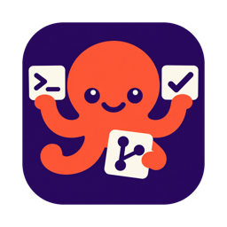
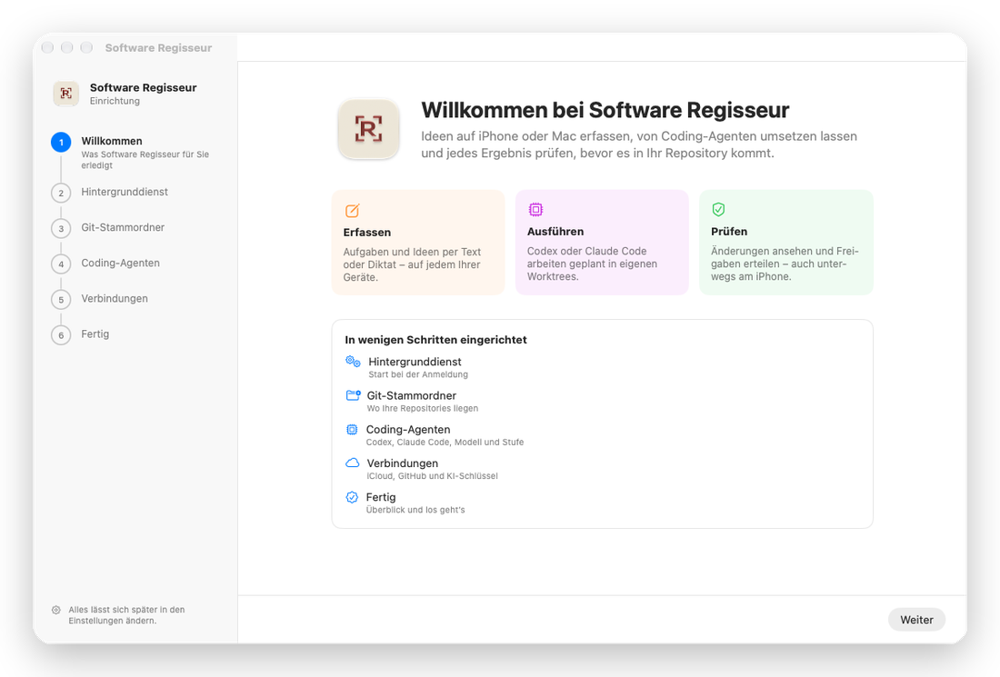
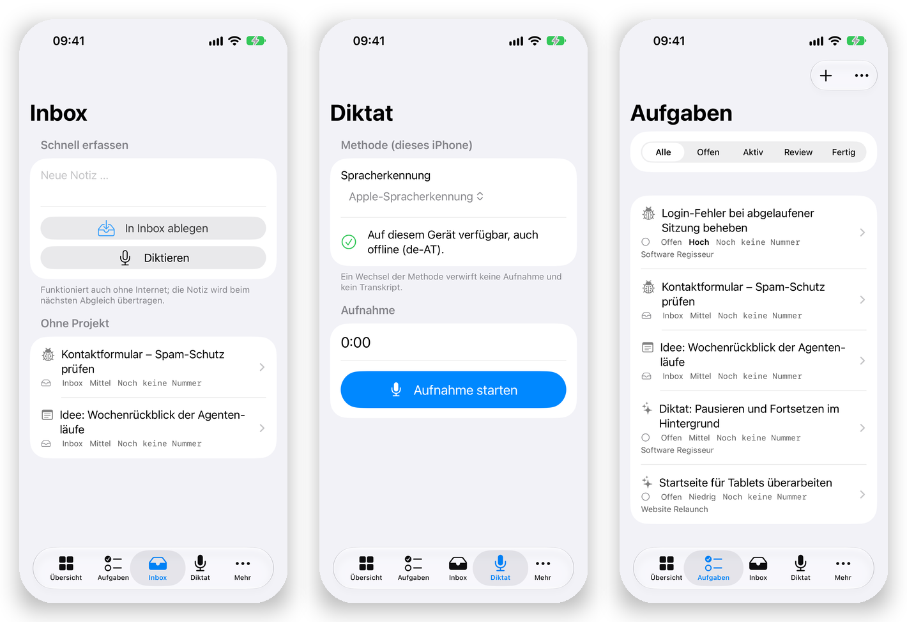
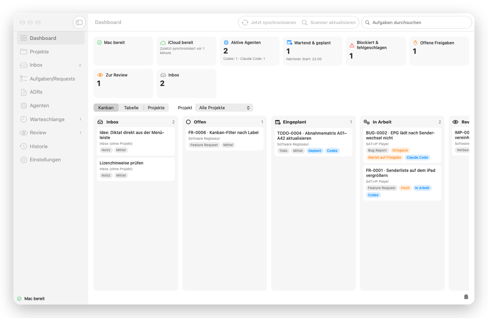
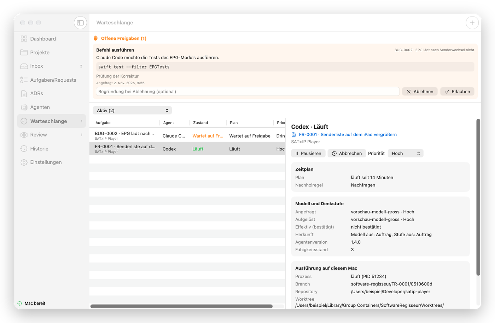
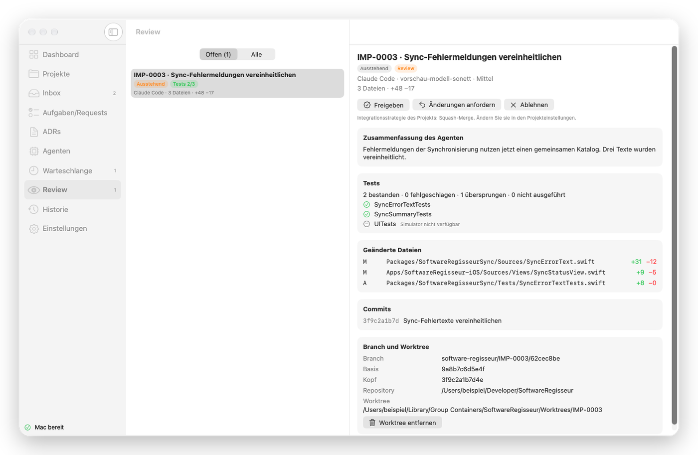

# Software Regisseur

**Sie haben die Idee. Die KI setzt sie um. Sie behalten Regie.**

Eine App für iPhone, iPad und Mac, mit der Sie Ideen für Ihre Software festhalten, 
vom KI-Programmierhelfer auf Ihrem eigenen Mac umsetzen lassen – und jedes Ergebnis prüfen, bevor es zählt.

 

## Worum geht es?

Gute Ideen kommen selten am Schreibtisch. Beim Spazierengehen, in der Bahn, kurz vor dem Einschlafen – und dann sind sie oft weg, bevor man wieder vor dem Computer sitzt.

**Software Regisseur** fängt sie ein. Und es macht mehr daraus als eine Notiz: Aus Ihrem Satz wird eine saubere Aufgabe, aus der Aufgabe eine fertige Änderung an Ihrer Software. Die eigentliche Programmierarbeit übernehmen KI-Helfer wie **Claude Code** oder **Codex**, die schon auf Ihrem Mac installiert sind. Sie sind dabei der Regisseur: Sie sagen, *was* passieren soll, *wann* und *mit welchem Helfer* – und Sie entscheiden am Ende, was übernommen wird.

## So funktioniert es

<table>
<tr>
<td width="25%" valign="top" align="center">

### 1 · Festhalten

Idee eintippen oder einfach **einsprechen** – auf iPhone, iPad oder Mac.

</td>
<td width="25%" valign="top" align="center">

### 2 · Ausarbeiten

Die KI macht aus Ihrem Gedanken eine klare Aufgabe mit Ziel und Prüfkriterien. Sie lesen drüber und übernehmen, was passt.

</td>
<td width="25%" valign="top" align="center">

### 3 · Umsetzen lassen

Ein KI-Helfer auf Ihrem Mac arbeitet die Aufgabe ab – sofort, zu einer Uhrzeit Ihrer Wahl oder nachts.

</td>
<td width="25%" valign="top" align="center">

### 4 · Prüfen

Sie sehen, was sich geändert hat, und geben es frei – oder bitten um Nachbesserung.

</td>
</tr>
</table>

## Unterwegs: das iPhone

Das iPhone ist Ihr Notizblock und Ihre Fernbedienung. Es funktioniert auch ohne Internet und auch dann, wenn Ihr Mac gerade ausgeschaltet ist – alles wird nachgereicht, sobald beide wieder verbunden sind.

- **Schnell erfassen:** ein Satz genügt. Ob getippt oder diktiert.
- **Diktieren:** einfach losreden. Die Sprache wird in Text verwandelt.
- **Aufgaben im Blick:** was ist offen, was läuft gerade, was wartet auf Ihre Prüfung?
- **Freigaben von unterwegs:** will der KI-Helfer etwas Heikles tun, fragt er bei Ihnen nach. Sie antworten bequem vom Sofa.

## Zuhause: der Mac

Der Mac ist die Werkstatt. Die App wohnt in der **Menüleiste** und arbeitet im Hintergrund – auch wenn das Fenster zu ist.

Auf dem **Dashboard** sehen Sie auf einen Blick, was gerade passiert: Welche Helfer arbeiten, was wartet, wo Ihre Entscheidung gebraucht wird. Die Tafel zeigt jede Aufgabe auf ihrem Weg von der Idee bis zum Ergebnis.

### Sie bestimmen, wer was wann macht

- **Eigener Helfer pro Aufgabe:** Claude Code oder Codex – und jeweils das passende KI-Modell und wie gründlich es nachdenken soll. Für eine kleine Korrektur reicht ein schneller Helfer, für knifflige Fälle darf es der gründliche sein.
- **Zeitplan:** sofort, heute Abend um 22 Uhr oder automatisch, sobald das Kontingent Ihres KI-Abos wieder aufgefüllt ist.
- **Freigaben statt Blindflug:** Möchte ein Helfer ein Programm starten oder etwas Ungewöhnliches tun, hält er an und wartet auf Ihr „Erlauben“ oder „Ablehnen“.

### Nichts passiert ohne Ihr Okay

Jeder Helfer arbeitet in einer **eigenen Kopie** Ihres Projekts. Ihre echte Arbeit bleibt unberührt, bis Sie zustimmen. Im **Review** sehen Sie:

- eine verständliche **Zusammenfassung**, was der Helfer getan hat,
- das **Testergebnis** – hat alles noch funktioniert?,
- **welche Dateien** sich wie stark geändert haben.

Dann entscheiden Sie: **Freigeben**, **Änderungen anfordern** oder **Ablehnen**.

## Gut zu wissen

| | |
|---|---|
| **Ihre Daten bleiben Ihre Daten** | Es gibt keinen Server von uns und kein Benutzerkonto. Alles läuft über Ihr eigenes iCloud und Ihren eigenen Mac. |
| **Eigene Schlüssel** | Für KI-Funktionen verwenden Sie Ihre eigenen Zugänge (OpenAI, Anthropic, Google). Sie liegen im verschlüsselten Schlüsselbund Ihres Geräts – nie im Klartext in Ihren Projekten oder in iCloud. |
| **Lesbar ohne die App** | Ihre Aufgaben sind ganz normale Textdateien in Ihrem Projekt. Sie bleiben lesbar und bearbeitbar, auch wenn Sie Software Regisseur nicht mehr verwenden. |
| **Sie behalten die Kontrolle** | Ihr Hauptprojekt wird erst nach Ihrer Freigabe verändert. Die KI sieht keine Passwörter oder Schlüssel aus Ihren Projekten – solche Inhalte werden vor dem Senden geschwärzt. Außerdem wird nichts ohne Ihr Wissen veröffentlicht. |
| **Auf Deutsch** | Die ganze Oberfläche ist auf Deutsch (Österreich). |

## Was Sie brauchen

- einen **Mac mit Apple-Chip** und macOS 26 oder neuer
- ein **iPhone oder iPad** mit iOS bzw. iPadOS 26 oder neuer (optional, aber der halbe Spaß)
- dieselbe **iCloud-Anmeldung** auf allen Geräten
- **Claude Code** und/oder **Codex** auf dem Mac, mit Ihrem eigenen Zugang angemeldet
- für Ausarbeitung und Diktat: einen **eigenen KI-Zugang** (API-Schlüssel) bei einem der unterstützten Anbieter

Beim ersten Start führt Sie die App Schritt für Schritt durch die Einrichtung – dauert nur wenige Minuten, und alles lässt sich später ändern.

## Mehr erfahren

- 📖 **[Handbuch](docs/handbuch/README.md)** – Installation, Einrichtung, KI-Schlüssel, Agenten, Synchronisierung, Datenschutz, häufige Fragen
- 🔒 **[Datenschutz](docs/handbuch/06-datenschutz.md)** – was gespeichert wird, was nie, und wie Sie alles exportieren oder löschen
- ❓ **[Grenzen und FAQ](docs/handbuch/07-grenzen-und-faq.md)**
- 🛠️ **[Für Entwickler](docs/ENTWICKLUNG.md)** – Aufbau des Projekts, Bauen, Testen, Architekturentscheidungen

## Lizenz

Der Quellcode ist öffentlich einsehbar, aber **nicht Open Source im Sinne der OSI**: Er steht unter der
[PolyForm Shield License 1.0.0](LICENSE). Jede Nutzung ist erlaubt, auch durch Unternehmen und für eigene
Zwecke; ausgeschlossen ist, ein Produkt oder einen Dienst anzubieten, der mit Software Regisseur
konkurriert (etwa Weiterverkauf, umbenannte Kopie oder gehosteter Dienst darauf).
